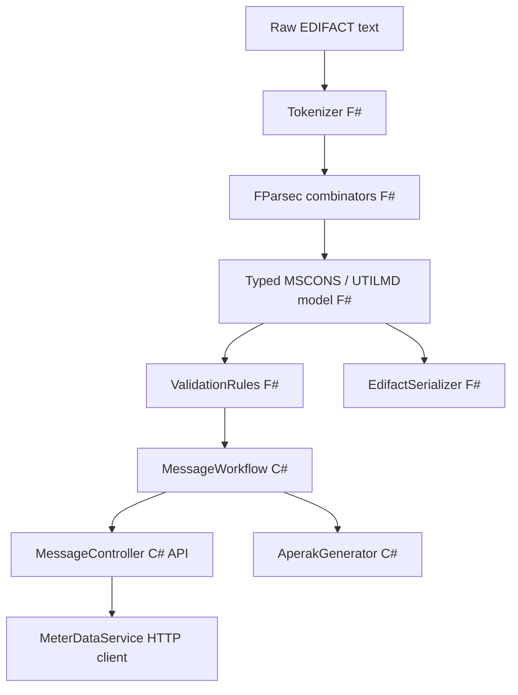
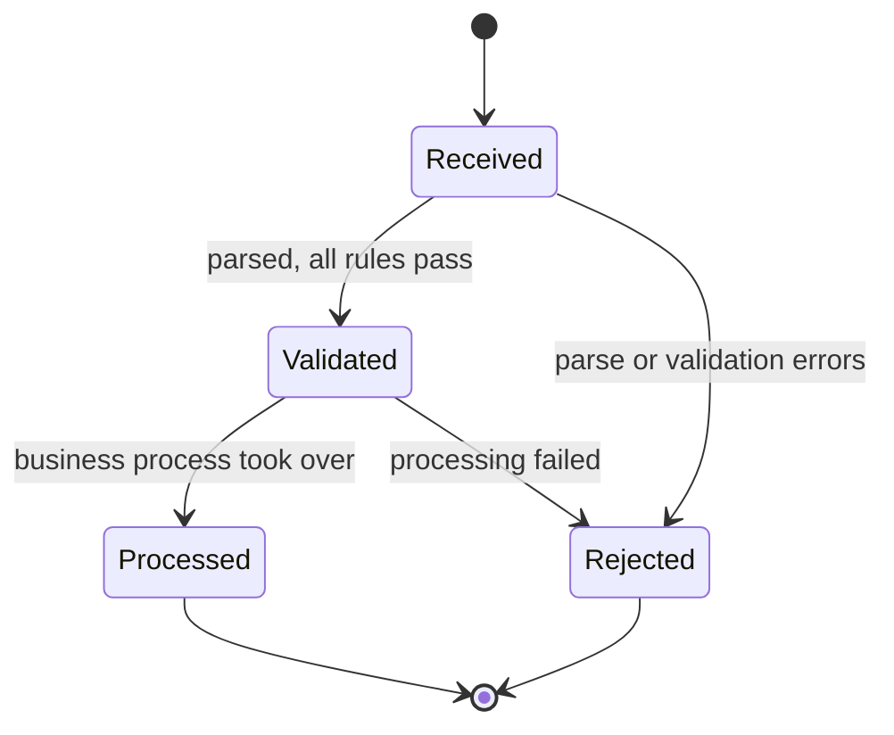
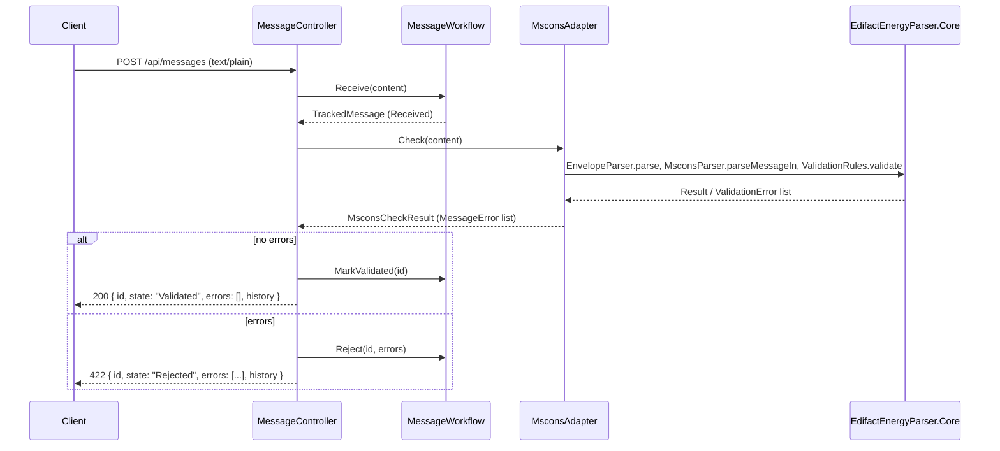

# edifact-energy-parser

> F# parser for EDIFACT energy messages (MSCONS, UTILMD) with a C# ASP.NET Core workflow API.


---

## Problem

Market communication in the German energy market is governed by EDIFACT-based message formats defined by the BDEW. Every supplier switch (Lieferantenwechsel), meter reading submission (MSCONS), and master data exchange (UTILMD) travels as a structured EDIFACT text file. Parsing these files correctly requires handling escape characters, optional segments, conditional group structures, and strict validation against the applicable application handbook (Anwendungshandbuch).

This project implements a typed EDIFACT parser in F# — chosen for its pattern-matching strength and discriminated unions that map naturally to segment alternatives — with a C# workflow layer that processes incoming messages through a state machine and generates APERAK-style acknowledgements.

---

## Features

- F# EDIFACT tokenizer: UNA service string advice, segments, composite elements, escape characters
- Envelope parser for UNB/UNH/UNT/UNZ with segment-count and reference checks, plus a writer for round-trips
- Parser combinators with FParsec for typed MSCONS (meter readings) and UTILMD (supplier switch / master data) models
- Validation rules as composable F# functions (`MsconsMessage -> ValidationError list`) that gather every violation instead of failing fast
- Round-trip guarantee: parse → model → serialize → parse produces identical models (FsCheck property tests)
- C# ASP.NET Core API: receive → validate → state machine (Received → Validated → Processed/Rejected) → APERAK-style response
- "Message explainer" endpoint: raw EDIFACT → human-readable JSON description of every segment
- MSCONS import feeding `meter-data-service` (cross-project integration)

---

## Innovation

_TODO: expand after implementation_

---

## Architecture



The tokenizer (`src/EdifactEnergyParser.Core/Tokenizer.fs`) is itself an FParsec parser: it reads the optional UNA segment first and then builds the segment parser from those delimiters, so one pass turns raw text into a flat `Token` stream (`SegmentTag`, `DataElement`, `ComponentElement`, `SegmentTerminator`) with escapes already resolved.

The envelope parser (`EnvelopeParser.fs`) works in three stages:
1. **Grammar (FParsec)** — checks the nesting `UNB (UNH segment* UNT)+ UNZ` on top of the tokenizer's segment parser and records where each service segment starts. Body segments are kept untouched for the MSCONS/UTILMD parsers.
2. **Typed conversion** — turns UNB/UNH/UNT/UNZ into an `InterchangeEnvelope` (sender, recipient, preparation time, control reference, message type, messages). A missing or malformed element becomes `InvalidElement` with line/column.
3. **Consistency checks** — UNT segment counts, UNZ message count, repeated references, and one message type per interchange. All findings are returned together as `EnvelopeError list`, since a rejection should name every problem.

UNB has no UTC offset, so the preparation time is read as local time in `Europe/Berlin` (or a zone passed to `parseIn`). A time in the repeated October hour counts as daylight time; a time in the skipped March hour is rejected. `EnvelopeWriter` serializes an envelope back to text and recomputes the trailer counts.

The MSCONS parser (`MsconsParser.fs`) takes the body segments of each message and follows the same two-stage pattern:
1. **Grammar (FParsec)** — header `BGM`, `DTM`…, `NAD`…, `UNS`; then per delivery party `NAD+DP` → `LOC [RFF]` → `LIN [PIA]` → `QTY DTM…` (each level repeating), with `opt` for the optional meter number (RFF), OBIS code (PIA) and contact (CTA/COM). FParsec reads characters, so the body is rendered one segment per line; the error line then gives the segment position as APERAK counts it (UNH = 1), e.g. `Expected LOC segment, found LIN` at position 8.
2. **Typed conversion** — into `MsconsMessage` → `MeteringPoint` → `TimeSeries` → `IntervalValue` with a `decimal` `Quantity`, its unit (KWH, MWH, KWT, MAW, MTQ) and a `ValueStatus` from the QTY qualifier (220 true value, 67 substitute, 201 proposed, 20 unusable). DTM format 303 keeps the sender's UTC offset, so a quarter hour across the October switch (`02:45+02` → `02:00+01`) is 15 minutes; formats 102/203 are read as German local time.

Only the segments needed for interval values are modelled; anything else in the body is a `StructureError`, not silently ignored.

The UTILMD parser (`UtilmdParser.fs`) uses the same two stages and shares the grammar runner (`SegmentGrammar.fs`) and DTM handling with MSCONS:
1. **Grammar (FParsec)** — header `BGM`, `DTM`…, `NAD [CTA COM…]`…; then one or more transactions `IDE` → `DTM`… → `STS` → `LOC`… → (`SEQ` `CAV`…)… → `NAD`…. UTILMD has no `UNS`, so the header ends where the first `IDE` starts.
2. **Typed conversion** — into `UtilmdMessage` → `SupplierSwitchTransaction` (transaction ID, `TransactionReason` from `STS+7`, start/end of supply from `DTM+92`/`DTM+93`, market location `LOC+Z16`, metering locations `LOC+Z17`) → `MasterDataRecord` (`SEQ` group with its `CAV` characteristics) and `TransactionParty` (`NAD`, e.g. the end customer `Z09` with name). Exactly one market location is required, and an end of supply must lie after the start.

`UtilmdError` has the same cases as `MsconsError` but requires qualified access (`UtilmdError.StructureError`), so the two parsers can be opened side by side without their case names shadowing each other.

Validation (`ValidationRules.fs`) runs after parsing and checks content that is well-formed but not acceptable. Each rule is a plain function `MsconsMessage -> ValidationError list`; `validateWith` combines a rule list with `List.collect`, so a rejection lists every problem at once (one `ValidationError` with segment tag and message per finding), and callers can pick their own rule set. `check` wraps the result as `Result<MsconsMessage, ValidationError list>`. The standard rules (`ValidationRules.all`):

| Rule | Segment | Check |
|------|---------|-------|
| `senderIsMarketPartnerId` / `recipientIsMarketPartnerId` | NAD | 13 ASCII digits (ILN/GLN or BDEW code number); the check digit is not enforced |
| `dateTimesInZone` | DTM | document date and every interval boundary carry the UTC offset `Europe/Berlin` has at that instant, e.g. `12:00+01` in July is rejected; both passes of the repeated October hour are accepted |
| `quantitiesNotNegative` | QTY | no negative amounts; zero is a real reading (PV at night) and direction is carried by the OBIS code |
| `hasMeteringPoint` | LOC | at least one metering point; the grammar already enforces it, but models built in code (API, generators) may not |

The serializer (`EdifactSerializer.fs`) is the inverse of the MSCONS parser: `serialize` / `serializeWith delimiters` turn an `MsconsMessage` into a complete interchange (UNA, UNB `UNOC:3`, UNH `MSCONS:D:04B:UN:2.4c`, body, recomputed UNT/UNZ counts via `EnvelopeWriter`). Every date is written as format 303 with the value's own UTC offset, so both passes of the repeated October hour stay distinct and no time zone is needed to read them back. Quantities use the UNA decimal mark, separators inside values are released with `?`, and NAD code lists are mapped to their UNB counterparts (293 → 500 BDEW, 9 → 14 GS1, 332 → 502 DVGW). For the sample, the written message is byte-identical to the original from UNH to UNT.

The serializer never writes text that would read back as a different model. An offset with minutes (e.g. `+05:30`, which format 303's whole-hour `ZZZ` cannot carry) is written in UTC, which keeps the instant. Values EDIFACT cannot represent are refused with one `ArgumentException` that lists every problem: empty texts (indistinguishable from an absent value), characters outside UNOC such as line breaks, and times with seconds. Business-rule violations (wrong ID format, wrong offset for Berlin, negative quantities, no metering points) are *not* refused, so a rejected message can still be written, e.g. for an error report.

The C# workflow (`src/EdifactEnergyParser.Workflow`) tracks each incoming message through a small state machine:



The allowed transitions live in one table (`MessageTransitions`); `MessageWorkflow` exposes `Receive`, `MarkValidated`, `MarkProcessed` and `Reject` and throws `InvalidOperationException` for anything else, e.g. processing a message that was never validated or touching a message that is already final. A correction from the sender is a new message, never a reopened one. The workflow does no parsing itself: the caller reports the outcome, so the class has no F# dependency. A rejection needs at least one `MessageError` (segment + text, the same shape as the F# `ValidationError`), because a negative APERAK without a reason gives the sender nothing to fix.

Each `TrackedMessage` is an immutable record with the raw text, current state, errors, a `Version` and a UTC history of every step. `InMemoryMessageStore` keeps them in a `ConcurrentDictionary` and replaces a message only if the stored snapshot is still the one the transition was based on (compare-and-swap via `TryUpdate`). If two requests race, the loser re-reads, sees the new state and fails the transition rule instead of overwriting the winner. `IMessageStore` is the seam for a database-backed store later.

`AperakGenerator` (C#, same project) writes the response to the sender as a complete EDIFACT interchange: `Accept` for an accepted message, `Reject` with one `ERC` code and `FTX` text per `MessageError`, or `For(trackedMessage, …)` to choose from the workflow state (a message still in `Received` has no outcome yet and is refused). The caller passes a `ReceivedInterchange` (original control reference, message reference, sender, recipient: four plain values the API copies out of the F# envelope) and a control reference for the response. A rejected MSCONS, answered on 1 July 2025 at 10:15 German time:

```
UNA:+.? '
UNB+UNOC:3+4012345000023:14+9900000000003:500+250701:1015+APK0001'
UNH+1+APERAK:D:07B:UN'
BGM+313+APK0001'
DTM+137:202507011015?+02:303'
RFF+ACW:MSC20251026'
RFF+ACE:MSG0042'
NAD+MS+4012345000023::9'
NAD+MR+9900000000003::293'
ERC+E20'
FTX+AAO+++QTY?: Quantity -1 is negative.'
UNT+10+1'
UNZ+1+APK0001'
```

- Sender and recipient swap; `RFF+ACW` carries the original interchange control reference, which is what the sender uses to match the answer, and `RFF+ACE` the original message reference.
- `BGM` 312 = acknowledgement, 313 = application error (UNCL 1001). The `ERC` codes are project-specific and deliberately coarse; the `FTX` text (prefixed with the segment tag) says what is wrong:

  | Code | Meaning |
  |------|---------|
  | `A00` | Accepted |
  | `E10` | Envelope or syntax problem (error on UNA/UNB/UNH/UNT/UNZ) |
  | `E20` | Business-rule violation in the message content |

- The document date is German local time with its UTC offset (format 303), so the two passes of the repeated October hour stay distinct.
- Delimiters in error texts are released with `?`. Line breaks become spaces and characters outside Latin-1 (UNOC) become `?`, because a reader would otherwise get a different text than we sent. Texts longer than `FTX` allows (5 × 512 characters) are split and then cut.
- One segment per line, which the tokenizer tolerates and which reads well in a log.

This is APERAK-*style*: segment choice and qualifiers follow UN/EDIFACT, but it does not implement any market-specific application handbook.

The API (`src/EdifactEnergyParser.Api`) ties the pieces together:



| Endpoint | Body | Responses |
|----------|------|-----------|
| `POST /api/messages` | raw EDIFACT, `Content-Type: text/plain` (UTF-8, or `charset=iso-8859-1` for UNOC files) | `200` validated · `422` rejected, with every error · `400` empty body or bytes that are not valid UTF-8 · `415` not `text/plain` |
| `GET /api/messages/{id}` | – | `200` current state, errors and history · `404` unknown ID (problem details) |

- **Adapter, not DI into F#.** `MsconsAdapter` is the only C# class that calls the F# modules. They stay plain functions; the adapter translates `Result`, F# lists and the error unions (`EnvelopeError`, `MsconsError`) into `MessageError(segment, text)`. Structure errors get the tag of the segment where parsing stopped; syntax errors keep line, column and FParsec's "Expecting: …" but drop its caret drawing. Validation errors are prefixed with the message reference (`Message 1: …`). The adapter also copies the four UNB/UNH values an APERAK needs into a `ReceivedInterchange`.
- **Store first, then check.** A message is stored as `Received` before parsing, so every message, even unreadable text, gets an ID and a history. Envelope, structure and rule errors all end in `Rejected` (422); only an empty body is a client error (400) with nothing stored.
- **Validated, not yet Processed.** Handing values to meter-data-service is the processing step; until it exists the API stops at `Validated`.
- **text/plain input.** `PlainTextInputFormatter` reads the body as UTF-8 or as Latin-1 when the client declares it. Latin-1 bytes sent without a charset are refused with a hint instead of being decoded into replacement characters.
- States are serialized as names (`"Rejected"`), and the store is an in-memory singleton: messages are lost on restart.

---

## Quick Start

```bash
dotnet run --project src/EdifactEnergyParser.Api
```

Receive, parse and validate an MSCONS message (200 with `"state": "Validated"`, or 422 with the error list):

```bash
curl -X POST http://localhost:5166/api/messages \
  -H "Content-Type: text/plain" \
  --data-binary @docs/samples/mscons_example.edi

curl http://localhost:5166/api/messages/<id from the response>
```

`src/EdifactEnergyParser.Api/EdifactEnergyParser.Api.http` has the same requests plus a rejected message and an unknown ID.

Explain a message (planned):

```bash
curl -X POST http://localhost:5166/api/messages/explain \
  -H "Content-Type: text/plain" \
  --data-binary @docs/samples/mscons_example.edi
```

---

## Domain Glossary

| German | English | Explanation |
|--------|---------|-------------|
| MSCONS | MSCONS | Meter reading results message; used to submit interval meter data |
| UTILMD | UTILMD | Utility master data message; used for supplier switch and contract data |
| APERAK | APERAK | Application error and acknowledgement message |
| GPKE | GPKE | Geschäftsprozesse zur Kundenbelieferung mit Elektrizität — regulatory process handbook |
| GeLi Gas | GeLi Gas | Geschäftsprozesse Lieferantenwechsel Gas — same for gas |
| Anwendungshandbuch | Application handbook | BDEW specification for a specific EDIFACT message type |
| Lieferantenwechsel | Supplier switch | Process by which a customer changes their energy supplier |
| Trennzeichenvorgabe (UNA) | Service string advice | Optional first six characters that redefine the delimiters; ISO 9735 defaults `:+.? '` apply without it |
| Freigabezeichen | Release character | Escape character (`?` by default) that makes the next delimiter literal, e.g. `?+` |
| Datenelement / Gruppendatenelement | Data element / composite data element | Values separated by `+`; a composite is split further into components by `:` |
| Übertragungsdatei (UNB…UNZ) | Interchange | One transmission between two market partners; UNZ repeats the UNB control reference and counts the messages |
| Nachricht (UNH…UNT) | Message | One business document inside an interchange; UNT counts its segments, UNH and UNT included |
| Datenaustauschreferenz | Interchange control reference | Sender-assigned ID of the interchange, used to match acknowledgements |
| Marktpartner-ID | Market-partner ID | 13-digit code of a market participant (BDEW/DVGW code number or GS1 GLN), sent in UNB as sender/recipient |
| Messlokation / Zählpunkt | Metering point | Where energy is measured; 33-character ID in MSCONS `LOC+172` |
| Lastgang | Load profile | Series of interval values (usually 15 minutes) for one metering point and register |
| OBIS-Kennzahl | OBIS code | Identifies the measured quantity, e.g. `1-1:1.29.0` consumption, `1-1:2.29.0` feed-in, per interval |
| Wahrer Wert / Ersatzwert / Vorschlagswert | True / substitute / proposed value | Value status from the QTY qualifier (220 / 67 / 201): measured, formed by the metering operator, or suggested |
| Marktlokation (MaLo) | Market location | Where energy is supplied and billed; 11-digit ID in UTILMD `LOC+Z16` |
| Vorgang | Transaction | One business case inside a UTILMD message, opened by `IDE+24` with its own transaction ID |
| Transaktionsgrund | Transaction reason | Why a transaction was sent (`STS+7`), e.g. supplier switch (Wechsel) or move in/out (Ein-/Auszug) |
| Lieferbeginn / Lieferende | Start / end of supply | When the new supplier starts or stops supplying the market location (`DTM+92` / `DTM+93`) |
| Endkunde | End customer | The consumer at the market location, named in `NAD+Z09` |
| ILN / GLN | Global location number | 13-digit GS1 number identifying a company; used, like BDEW code numbers, as market-partner ID |
| Bestätigung / Ablehnung | Acknowledgement / rejection | The two outcomes an APERAK reports back for a received message |
| Bezugsnachricht | Referenced message | The original message an APERAK answers, identified by its interchange control reference (`RFF+ACW`) |
| Prüffehler | Validation error | A message that parses but breaks a business rule; reported back to the sender via APERAK |

---

## Testing

```bash
dotnet test
```

Coverage highlights:
- Tokenizer: UNA-present and UNA-absent input, custom delimiters, release-character escapes, empty elements, line breaks between segments, and error positions (line/column) for malformed input
- Envelope: typed UNB/UNH fields, text round-trip (parse → write), model round-trip with custom delimiters and escapes, segment/message count and reference mismatches (reported together), mixed message types, missing UNT/UNZ, and UNB times across both DST transitions (summer offset, repeated October hour, skipped March hour)
- MSCONS: the 3-metering-point sample in `docs/samples/mscons_example.edi` (counts, exact `decimal` sums, OBIS codes, value statuses, contiguous intervals), a quarter hour across the October DST switch, local date format 102, decimal comma from UNA, optional PIA/RFF/CTA present and absent, and structure/element errors with their segment position
- UTILMD: the 2-transaction sample in `docs/samples/utilmd_example.edi` (supplier switch and move-in, master data groups, end customer names), start of supply as format 303 and as local date 102 (winter and summer offset), a start in the March DST gap, missing STS / start of supply / market location, end before start, unsupported LOC qualifier, and MSCONS vs. UTILMD rejecting each other's messages
- Serializer: the sample survives parse → serialize → parse and its message is written byte-identical (UNH…UNT), NAD → UNB code lists, both passes of the repeated October hour, decimal comma, released separators, offsets with minutes, refusal of control characters / seconds / empty values, and messages with rule violations still serialize
- Round-trip property tests (FsCheck, `RoundTripProperties.fs`), 10 000 cases each:
  - `parse (serialize msg) = Ok msg` for random messages *and* random UNA delimiters (shuffled separators, release character, decimal point or comma). Texts mix letters, digits, every delimiter character and Latin-1 umlauts; times use Berlin and other whole-hour offsets plus `+05:30`; quantities include zero, negatives, `Decimal.MaxValue`/`MinValue` and 28-digit scale
  - With unrestricted content (empty texts, line breaks, `€`, CJK, seconds) the serializer either refuses the message or writes text that parses back unchanged (about half of the cases each)
  - Hand-written shrinkers drop list items, shorten texts and reset values, so a failure is reported as a one-value message. The first runs found two bugs: a `+05:30` offset written as `+05` (instant moved 30 minutes) and a `\r` in a party ID read back as `\n` (FParsec newline normalization); both are fixed and kept as unit tests
- Escape character edge cases in segment data
- Validation: a valid message and the parsed sample (with a zero reading) return `[]`; a message with three violations returns exactly three `ValidationError`s; every violation of a rule is reported; non-13-digit and non-ASCII-digit party IDs; empty metering points; wrong offsets (summer time sent as `+01`, document date in UTC) and both DST transitions (repeated October hour, March switch); custom rule lists and a different zone
- Workflow state machine (C#, `tests/EdifactEnergyParser.Tests.Workflow`, xUnit + Shouldly): the transition table for all 16 state pairs, every valid transition and every forbidden one reachable through a method (message left unchanged), the accepted path Received → Validated → Processed and both rejection paths with errors and a timestamped history (`FakeTimeProvider`), rejection without errors, unknown IDs, and 16 threads racing to process/reject one message (exactly one wins). The in-memory store refuses duplicate IDs and stale snapshots
- APERAK generator (same C# test project, which references the F# core only to read responses back): every response is tokenized and parsed by `EnvelopeParser`, so syntax, UNT segment count and UNZ control reference are checked. A rejection names the original control number and every error (code + text, in order); an acceptance carries `BGM` 312 and `ERC+A00`; released delimiters read back unchanged; line breaks, `€` and over-long texts; partners with and without code list; the document date in winter, summer, both passes of the repeated October hour and after the March switch; refusal of rejections without errors and of empty/over-long references; and the response chosen from the workflow state
- API end to end (`tests/EdifactEnergyParser.Tests.Integration`, `WebApplicationFactory` + a synthetic MSCONS builder): a valid message is `Validated` (200) and can be fetched again; rule violations, a broken UNT count and non-EDIFACT text are `Rejected` (422) with every error and stay stored; states are serialized as names; a Latin-1 body with `charset=iso-8859-1` is accepted and without a charset is a 400 with a hint; empty and whitespace bodies are 400, JSON is 415, unknown and non-GUID IDs are 404. Adapter tests cover the docs sample, the UNB references copied for APERAK, envelope/syntax/structure/wrong-type errors and the segment tag each one names

---

## Design Decisions

See `docs/adr/` for Architecture Decision Records.

---

## Roadmap / Next Steps

- Full UTILMD supplier-switch workflow
- CONTRL acknowledgement (syntax-level)
- Performance: parse 1 MB MSCONS in < 100 ms

---

## Kurzfassung auf Deutsch

Dieses Projekt implementiert einen vollständigen EDIFACT-Parser in F# für die im deutschen Energiemarkt verwendeten Nachrichtenformate MSCONS und UTILMD. Der Tokenizer verarbeitet die UNA-Zeichenkette, alle Segmentgruppen sowie Sonderzeichen gemäß den BDEW-Spezifikationen. Mit FParsec-Kombinatoren werden typisierte F#-Modelle erzeugt, die durch komponierbare Validierungsregeln geprüft werden. Eine Round-Trip-Garantie wird durch FsCheck-Eigenschaftstests sichergestellt. Der C#-Workflow-Layer nimmt Nachrichten über eine ASP.NET Core API entgegen, führt sie durch eine Zustandsmaschine und erzeugt APERAK-ähnliche Antworten. Ein „Message Explainer"-Endpunkt übersetzt rohe EDIFACT-Nachrichten in menschenlesbare JSON-Beschreibungen.
