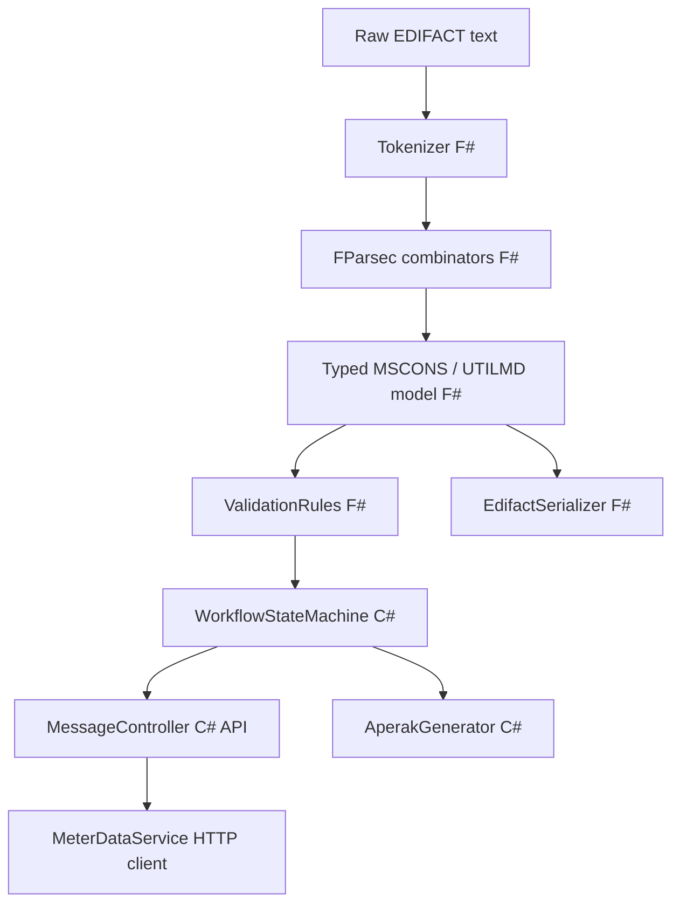

# edifact-energy-parser

> F# parser for EDIFACT energy messages (MSCONS, UTILMD) with a C# ASP.NET Core workflow API.


---

## Problem

Market communication in the German energy market is governed by EDIFACT-based message formats defined by the BDEW. Every supplier switch (Lieferantenwechsel), meter reading submission (MSCONS), and master data exchange (UTILMD) travels as a structured EDIFACT text file. Parsing these files correctly requires handling escape characters, optional segments, conditional group structures, and strict validation against the applicable application handbook (Anwendungshandbuch).

This project implements a typed EDIFACT parser in F# — chosen for its pattern-matching strength and discriminated unions that map naturally to segment alternatives — with a C# workflow layer that processes incoming messages through a state machine and generates APERAK-style acknowledgements.

---

## Features

- F# EDIFACT tokenizer: UNA service string advice, segments, composite elements, escape characters
- Envelope parser for UNB/UNH/UNT/UNZ with segment-count and reference checks, plus a writer for round-trips
- Parser combinators with FParsec for typed MSCONS (meter readings) and UTILMD (supplier switch / master data) models
- Validation rules as composable F# functions returning `Result<'T, ValidationError list>`
- Round-trip guarantee: parse → model → serialize → parse produces identical models (FsCheck property tests)
- C# ASP.NET Core API: receive → validate → state machine (Received → Validated → Processed/Rejected) → APERAK-style response
- "Message explainer" endpoint: raw EDIFACT → human-readable JSON description of every segment
- MSCONS import feeding `meter-data-service` (cross-project integration)

---

## Innovation

_TODO: expand after implementation_

---

## Architecture



The tokenizer (`src/EdifactEnergyParser.Core/Tokenizer.fs`) is itself an FParsec parser: it reads the optional UNA segment first and then builds the segment parser from those delimiters, so one pass turns raw text into a flat `Token` stream (`SegmentTag`, `DataElement`, `ComponentElement`, `SegmentTerminator`) with escapes already resolved.

The envelope parser (`EnvelopeParser.fs`) works in three stages:
1. **Grammar (FParsec)** — checks the nesting `UNB (UNH segment* UNT)+ UNZ` on top of the tokenizer's segment parser and records where each service segment starts. Body segments are kept untouched for the MSCONS/UTILMD parsers.
2. **Typed conversion** — turns UNB/UNH/UNT/UNZ into an `InterchangeEnvelope` (sender, recipient, preparation time, control reference, message type, messages). A missing or malformed element becomes `InvalidElement` with line/column.
3. **Consistency checks** — UNT segment counts, UNZ message count, repeated references, and one message type per interchange. All findings are returned together as `EnvelopeError list`, since a rejection should name every problem.

UNB has no UTC offset, so the preparation time is read as local time in `Europe/Berlin` (or a zone passed to `parseIn`). A time in the repeated October hour counts as daylight time; a time in the skipped March hour is rejected. `EnvelopeWriter` serializes an envelope back to text and recomputes the trailer counts.

The MSCONS parser (`MsconsParser.fs`) takes the body segments of each message and follows the same two-stage pattern:
1. **Grammar (FParsec)** — header `BGM`, `DTM`…, `NAD`…, `UNS`; then per delivery party `NAD+DP` → `LOC [RFF]` → `LIN [PIA]` → `QTY DTM…` (each level repeating), with `opt` for the optional meter number (RFF), OBIS code (PIA) and contact (CTA/COM). FParsec reads characters, so the body is rendered one segment per line; the error line then gives the segment position as APERAK counts it (UNH = 1), e.g. `Expected LOC segment, found LIN` at position 8.
2. **Typed conversion** — into `MsconsMessage` → `MeteringPoint` → `TimeSeries` → `IntervalValue` with a `decimal` `Quantity`, its unit (KWH, MWH, KWT, MAW, MTQ) and a `ValueStatus` from the QTY qualifier (220 true value, 67 substitute, 201 proposed, 20 unusable). DTM format 303 keeps the sender's UTC offset, so a quarter hour across the October switch (`02:45+02` → `02:00+01`) is 15 minutes; formats 102/203 are read as German local time.

Only the segments needed for interval values are modelled; anything else in the body is a `StructureError`, not silently ignored.

---

## Quick Start

```bash
dotnet run --project src/EdifactEnergyParser.Api
```

Parse a MSCONS message:

```bash
curl -X POST http://localhost:5001/api/messages \
  -H "Content-Type: text/plain" \
  --data-binary @docs/samples/mscons_example.edi
```

Explain a message:

```bash
curl -X POST http://localhost:5001/api/messages/explain \
  -H "Content-Type: text/plain" \
  --data-binary @docs/samples/mscons_example.edi
```

---

## Domain Glossary

| German | English | Explanation |
|--------|---------|-------------|
| MSCONS | MSCONS | Meter reading results message; used to submit interval meter data |
| UTILMD | UTILMD | Utility master data message; used for supplier switch and contract data |
| APERAK | APERAK | Application error and acknowledgement message |
| GPKE | GPKE | Geschäftsprozesse zur Kundenbelieferung mit Elektrizität — regulatory process handbook |
| GeLi Gas | GeLi Gas | Geschäftsprozesse Lieferantenwechsel Gas — same for gas |
| Anwendungshandbuch | Application handbook | BDEW specification for a specific EDIFACT message type |
| Lieferantenwechsel | Supplier switch | Process by which a customer changes their energy supplier |
| Trennzeichenvorgabe (UNA) | Service string advice | Optional first six characters that redefine the delimiters; ISO 9735 defaults `:+.? '` apply without it |
| Freigabezeichen | Release character | Escape character (`?` by default) that makes the next delimiter literal, e.g. `?+` |
| Datenelement / Gruppendatenelement | Data element / composite data element | Values separated by `+`; a composite is split further into components by `:` |
| Übertragungsdatei (UNB…UNZ) | Interchange | One transmission between two market partners; UNZ repeats the UNB control reference and counts the messages |
| Nachricht (UNH…UNT) | Message | One business document inside an interchange; UNT counts its segments, UNH and UNT included |
| Datenaustauschreferenz | Interchange control reference | Sender-assigned ID of the interchange, used to match acknowledgements |
| Marktpartner-ID | Market-partner ID | 13-digit code of a market participant (BDEW/DVGW code number or GS1 GLN), sent in UNB as sender/recipient |
| Messlokation / Zählpunkt | Metering point | Where energy is measured; 33-character ID in MSCONS `LOC+172` |
| Lastgang | Load profile | Series of interval values (usually 15 minutes) for one metering point and register |
| OBIS-Kennzahl | OBIS code | Identifies the measured quantity, e.g. `1-1:1.29.0` consumption, `1-1:2.29.0` feed-in, per interval |
| Wahrer Wert / Ersatzwert / Vorschlagswert | True / substitute / proposed value | Value status from the QTY qualifier (220 / 67 / 201): measured, formed by the metering operator, or suggested |

---

## Testing

```bash
dotnet test
```

Coverage highlights:
- Tokenizer: UNA-present and UNA-absent input, custom delimiters, release-character escapes, empty elements, line breaks between segments, and error positions (line/column) for malformed input
- Envelope: typed UNB/UNH fields, text round-trip (parse → write), model round-trip with custom delimiters and escapes, segment/message count and reference mismatches (reported together), mixed message types, missing UNT/UNZ, and UNB times across both DST transitions (summer offset, repeated October hour, skipped March hour)
- MSCONS: the 3-metering-point sample in `docs/samples/mscons_example.edi` (counts, exact `decimal` sums, OBIS codes, value statuses, contiguous intervals), a quarter hour across the October DST switch, local date format 102, decimal comma from UNA, optional PIA/RFF/CTA present and absent, and structure/element errors with their segment position
- Round-trip property tests (FsCheck): 10 000+ generated messages satisfy parse → serialize → parse identity
- Escape character edge cases in segment data
- All validation error paths return structured `ValidationError` with segment reference
- State machine: all valid and invalid transitions covered

---

## Design Decisions

See `docs/adr/` for Architecture Decision Records.

---

## Roadmap / Next Steps

- Full UTILMD supplier-switch workflow
- CONTRL acknowledgement (syntax-level)
- Performance: parse 1 MB MSCONS in < 100 ms

---

## Kurzfassung auf Deutsch

Dieses Projekt implementiert einen vollständigen EDIFACT-Parser in F# für die im deutschen Energiemarkt verwendeten Nachrichtenformate MSCONS und UTILMD. Der Tokenizer verarbeitet die UNA-Zeichenkette, alle Segmentgruppen sowie Sonderzeichen gemäß den BDEW-Spezifikationen. Mit FParsec-Kombinatoren werden typisierte F#-Modelle erzeugt, die durch komponierbare Validierungsregeln geprüft werden. Eine Round-Trip-Garantie wird durch FsCheck-Eigenschaftstests sichergestellt. Der C#-Workflow-Layer nimmt Nachrichten über eine ASP.NET Core API entgegen, führt sie durch eine Zustandsmaschine und erzeugt APERAK-ähnliche Antworten. Ein „Message Explainer"-Endpunkt übersetzt rohe EDIFACT-Nachrichten in menschenlesbare JSON-Beschreibungen.
